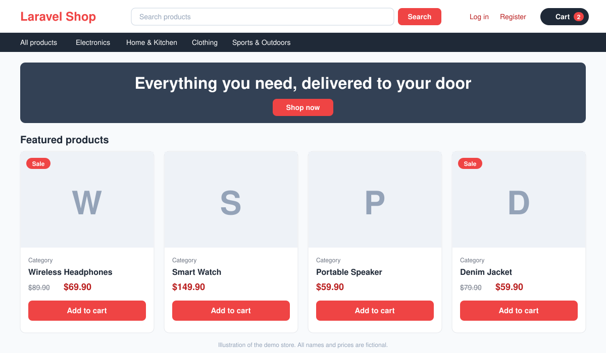

# Laravel Shop

A free, complete e-commerce starter for **Laravel 13** (PHP 8.3). Download it, run three commands and you have a working online store with a catalog, cart, checkout, customer accounts and an admin panel, in the spirit of OpenCart but on a modern Laravel codebase you can read and change.



> The image above is an illustration of the demo store, not a screenshot.

## Features

**Storefront**
- Home page with featured products, categories and new arrivals
- Catalog with search, category filter, sorting and pagination
- Product page with sale price, stock and related products
- Session cart, quantity limits based on stock, coupon codes
- Checkout for guests or registered customers
- Order confirmation, order tracking by number and email, email notifications
- Customer registration, login, password reset, profile and order history

**Payments**
- Stripe (Checkout), PayPal (Orders v2) and Mercado Pago (Checkout Pro)
- Cash on delivery and bank transfer
- Each online gateway turns on by itself when its keys are in `.env`
- Webhooks with signature check (Stripe) and server-side payment lookup (Mercado Pago)

**Admin panel** (`/admin`)
- Dashboard with revenue, orders, pending orders, customers and low stock
- Products (image upload, sale price, stock, featured, hide), categories, coupons
- Orders: filters, status updates, mark as paid, CSV export, stock restored on cancel
- Customer list with order counts and totals

**Under the hood**
- Prices stored as integer cents, order lines keep the price paid
- Stock is locked inside a database transaction at checkout
- Form Requests, Eloquent, migrations, factories, seeders, Mailables, Gate, Http client
- Plain CSS, no Node, no Vite, no build step
- SQLite by default, MySQL and PostgreSQL ready in `config/database.php`

## Install

Requirements: PHP 8.3+, Composer, SQLite (or MySQL/PostgreSQL).

```bash
git clone https://github.com/lenivalestevao/laravel-ecommerce.git
cd laravel-ecommerce
composer install
php artisan shop:install
php artisan serve
```

`php artisan shop:install` does everything else for you. It is safe to run again, and it never deletes data unless you add `--fresh`:

- creates the `.env` file and the app key
- creates the database (the SQLite file, or the MySQL/MariaDB database if the server lets it)
- creates all the tables with the migrations
- adds demo categories, products and coupons (skipped if the shop already has data)
- makes sure there is an admin account and links `public/storage`

Options:

| Option | What it does |
| --- | --- |
| `--no-seed` | Skip the demo products and coupons, for a clean store |
| `--fresh` | Drop every table and start over (**deletes all data**) |
| `--admin-email=you@store.com --admin-password=...` | Create your own admin account |

`composer setup` runs the same command. Prefer the manual way? `php artisan key:generate && php artisan migrate --seed` also works.

Open http://localhost:8000. The seeder creates demo categories, products and two coupons (`WELCOME10`, `SAVE5`).

| Account | Email | Password |
| --- | --- | --- |
| Admin | admin@example.com | password |
| Customer | customer@example.com | password |

**Change these before going live**, or delete the two users and create your own admin:

```bash
php artisan tinker
>>> App\Models\User::create(['name' => 'You', 'email' => 'you@yourstore.com', 'password' => 'a-strong-password', 'is_admin' => true]);
```

## Configure your store

Edit `.env` and `config/shop.php`:

| Setting | What it does |
| --- | --- |
| `APP_NAME` | Store name |
| `SHOP_CURRENCY` | Symbol shown next to prices |
| `SHOP_SHIPPING_FEE`, `SHOP_FREE_SHIPPING_OVER` | Flat shipping and free shipping threshold, in cents |
| `SHOP_TAX_RATE` | Tax in percent, added after discounts |
| `MAIL_*` | Use `smtp` in production. The default `log` driver writes emails to `storage/logs` |

Remove the demo products from the admin panel and add your own.

## Payments

Put the keys in `.env`. A gateway shows up at checkout only when it is configured.

**Stripe**
1. Set `STRIPE_SECRET` (and `STRIPE_CURRENCY`).
2. Add a webhook pointing to `https://your-domain/payment/webhook/stripe` for the event `checkout.session.completed`, then set `STRIPE_WEBHOOK_SECRET`.

**PayPal**
1. Set `PAYPAL_CLIENT_ID`, `PAYPAL_SECRET` and `PAYPAL_CURRENCY`.
2. Keep `PAYPAL_SANDBOX=true` until you have tested, then set it to `false` with live credentials.

**Mercado Pago**
1. Set `MERCADOPAGO_ACCESS_TOKEN` and `MERCADOPAGO_CURRENCY`.
2. The notification URL is sent with every payment: `https://your-domain/payment/webhook/mercadopago` (it must be reachable from the internet).

Each gateway is a small class in `app/Payments` implementing `Gateway`. To add another one, create a class and register it in `PaymentManager`.

## Tests

```bash
php artisan test
```

The suite covers catalog, cart, coupons, checkout, stock, payments (with faked HTTP responses), admin and accounts.

## Status and honesty notes

- This project is written for Laravel 13, but the author could **not run `composer install` or the test suite** in the environment where it was written (no network). The code was checked with `php -l` and by cross-checking route and view names. If something fails on your machine, please open an issue with the error.
- The payment gateways are tested with fake HTTP responses only. **Run a real payment in each provider's sandbox before accepting money.** Provider APIs change.
- PayPal: the customer return URL captures the payment. If you rely on PayPal webhooks, verify their signature before trusting them (see `PayPalGateway::webhook`).
- Bank transfer instructions are placeholder text in `resources/views/checkout/show.blade.php`. Put your own bank details there.
- Review security, taxes, invoicing and legal requirements for your country (privacy policy, terms, consumer rights) before selling.
- Apache needs `public/.htaccess` (included). With Nginx, point the root at `public/` and send everything to `index.php`.

## Project layout

```
app/Http/Controllers        storefront controllers (Admin/ for the panel)
app/Http/Requests           validation
app/Models                  User, Category, Product, Coupon, Order, OrderItem
app/Payments                Stripe, PayPal, Mercado Pago and PaymentManager
app/Services                CheckoutService (order creation, stock)
app/Support                 Cart, Totals, Money
config/shop.php             store settings
database/                   migrations, factories, demo seeder
resources/views             Blade views, components, emails
public/css/shop.css         all styling
tests/Feature               feature tests
```

## License

MIT. Use it for personal or commercial projects. If it helps you, a ⭐ on the repository is much appreciated.
